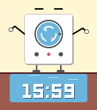

# Mr. Washy

An anthropomorphic washing machine watchface for Pebble smartwatches.

   

## Features

- **Animated wash cycle** - Clothes (sock and shirt) tumble inside the door with rotating suds
- **Overflow animation** - Each minute, the door opens and water overflows to reveal the updated time. A sock tumbles out with the water before sliding back under the machine
- **Living character** - Eyes blink and look around, arms sway gently
- **Info corners** - Optional weather, steps, heart rate or battery in the top corners
- **Themes** - Five color presets or your own wall and floor colors
- **Sleepy mode** - Animation stops during Quiet Time or while you sleep
- **Battery efficient** - No continuous timer. Brief redraws only during blinks (every 5-9s) and the minute overflow animation; seconds are opt-in
- **All platforms** - Runs on every Pebble watch with automatic color/B&W and round/rectangular adaptation

## Supported Platforms

| Platform | Model | Screen | Colors |
|----------|-------|--------|--------|
| aplite | Pebble Classic | 144x168 rect | B&W |
| basalt | Pebble Time | 144x168 rect | 64-color |
| chalk | Pebble Time Round | 180x180 round | 64-color |
| diorite | Pebble 2 | 144x168 rect | B&W |
| emery | Pebble Time 2 | 200x228 rect | 64-color |
| flint | Pebble 2 Duo | 144x168 rect | 64-color |
| gabbro | Pebble Round 2 | 260x260 round | 64-color |

## Install

**From the App Store:**
[Mr. Washy on Pebble App Store](https://apps.rePebble.com/cd39c6e9c4134fb388376793)

**From source:**
```bash
pebble build
pebble install --cloudpebble     # physical watch
pebble install --emulator emery  # emulator
```

## Settings

Open the Pebble app on your phone, go to the Mr. Washy settings:

- **Time & Date** - Time format (watch default, 12-hour, 24-hour), seconds, date and date style
- **Extras** - What to show in the top-left and top-right corners: weather, steps, heart rate or battery; °F or °C
- **Theme** - Classic, Midnight, Mint, Lavender, Sunset, or custom wall/floor colors
- **Watch** - Sleepy Mr. Washy (no animation during Quiet Time or sleep), buzz on phone disconnect

Weather comes from [Open-Meteo](https://open-meteo.com/) (no API key) using your phone's location, refreshed every 30 minutes.

Settings are powered by [Clay](https://github.com/pebble/clay) and persist across watch restarts.

## Project Structure

```
washTimeWatchFace/
  package.json                # Pebble app manifest
  wscript                     # Waf build config
  CLAUDE.md                   # AI assistant context
  src/
    c/
      washTimeWatchFace.c     # Complete watchface (single file)
    pkjs/
      index.js                # Settings + weather fetch
      config.js               # Settings page definition
      custom-clay.js          # Show/hide settings on the config page
      weather.js              # Open-Meteo URL + response mapping
  test/                       # JS tests; test/c has desktop C tests for src/c/logic.c
  resources/                  # (empty - uses system fonts only)
```

## Architecture

### Animation State Machine

```
IDLE ──(minute tick)──> OPEN ──> OVER ──> POOL ──> RECEDE ──> SETTLE ──> IDLE
                        door     drops    time     door       pause
                        opens    fall     shows    closes
```

- **Idle**: No continuous timer. A blink fires every 5-9 seconds, briefly nudging the wash cycle and arm position
- **Overflow**: Runs at 20 FPS (50ms) for ~2.5 seconds, then stops

### Drawing (Painter's Algorithm)

Back to front: background > puddle > time > falling sock > legs > body > door (with laundry + suds) > knobs > arms > eyes > water drops

### Multi-Platform Support

- **Layout**: All positions computed as ratios of screen bounds via `layer_get_unobstructed_bounds()`
- **Colors**: `CLR_*` palette macros using `PBL_IF_COLOR_ELSE()` for automatic B&W fallback
- **Fonts**: Adaptive sizing (`LECO_36` on large screens, `LECO_28` on small)
- **Round**: Date positioned relative to time on round displays using `PBL_IF_ROUND_ELSE()`

## Development

Requires the [Pebble SDK](https://developer.repebble.com/sdk/).

```bash
pebble build                                    # Build PBW for all platforms
pebble install --emulator emery                 # Test in emulator
pebble screenshot --no-open --emulator emery    # Capture screenshot
pebble logs --emulator emery                    # View runtime logs
pebble publish                                  # Publish to App Store
```

After modifying `package.json` dependencies, run `npm install` before building.

```bash
npm test           # JS tests + desktop C tests (needs gcc)
npm run check      # tests + pebble build for every platform; run before pushing
```

## Changelog

See [CHANGELOG.md](CHANGELOG.md).

## License

MIT, see [LICENSE](LICENSE).
